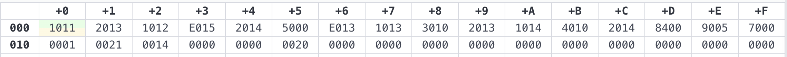
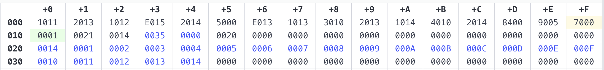
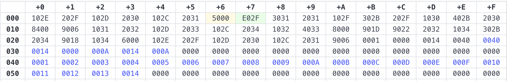
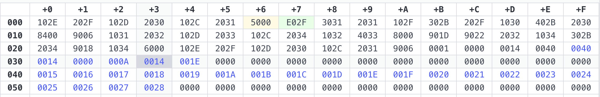

# Reporte Final de Situación Problema

## Modelación de sistemas mínimos y arquitecturas computacionales

---

## I. Introducción y Problemáticas en la Industria Automotriz

La electrónica automotriz desempeña un papel fundamental en el correcto funcionamiento de los vehículos modernos. Los avanzados módulos computacionales presentes en los vehículos se encargan de garantizar un funcionamiento eficiente del motor, gestionar los componentes de chasis y carrocería, así como asegurar la seguridad de los ocupantes y otros usuarios de la vía. (Jiménez, 2025).

A continuación se identifican tres de las principales problemáticas en la industria automotriz resueltas mediante sistemas electrónicos:

- **Eficiencia en la combustión y control de emisiones contaminantes:**
  - **Problemática:** La mezcla inadecuada de aire y combustible genera un alto consumo de gasolina y emisiones nocivas (CO, NOx, HC).
  - **Solución Electrónica:** Sistema de Inyección Electrónica de Combustible y monitoreo catalítico mediante la Unidad de Control del Motor (ECU).
- **Seguridad activa y estabilidad del vehículo:**
  - **Problemática:** El bloqueo de ruedas durante un frenado de emergencia o maniobra brusca provoca la pérdida del control de la dirección y derrapes.
  - **Solución Electrónica:** Sistema de Frenos Antibloqueo (ABS) y Control Electrónico de Estabilidad (ESP).
- **Protección contra impactos y seguridad pasiva de los pasajeros:**
  - **Problemática:** Ante una colisión o volcamiento, las fuerzas del impacto causan choques de los pasajeros contra la estructura interna del vehículo, provocando lesiones severas o fatales.
  - **Solución Electrónica:** Módulo de Control de Airbags (SRS) con sensores de desaceleración y satélites de impacto distribuidos en el chasis, que calculan e inflan las bolsas de aire y tensan los cinturones de seguridad en milisegundos.

---

## II. Variables Asociadas, Estudio y Análisis Computacional

Para que los sistemas ciberfísicos automotrices puedan resolver las problemáticas planteadas, es indispensable la captura, digitalización y procesamiento de variables físicas y químicas mediante sensores. En la siguiente tabla se enumeran las variables asociadas con las problemáticas planteadas, en conjunto con el tipo de variable, su unidad de medida, el sensor encargado y el módulo (sistema) al que pertenece (acorde a Medina-Santiago, 2018):

| Problemática Automotriz                                                                         | Variable Asociada                     | Tipo (magnitud y señal) | Unidad de Medida                         | Sensor Encargado                    | Módulo (sistema)                               |
| :---------------------------------------------------------------------------------------------- | :------------------------------------ | :---------------------- | :--------------------------------------- | :---------------------------------- | :--------------------------------------------- |
| **Eficiencia en la combustión y control de emisiones contaminantes**                            | Flujo de masa de aire                 | Física / Analógica      | Gramos por segundo ($g/s$) o Voltios (V) | Sensor de masa de aire (MAF)        | Unidad de Control del Motor (ECU)              |
|                                                                                                 | Revoluciones del motor                | Física / Digital        | Revoluciones por minuto (RPM)            | Sensor de Cigüeñal                  |                                                |
|                                                                                                 | Concentración de oxígeno en el escape | Química / Analógica     | Voltios (V)                              | Sonda Lambda (Sensor O2)            |                                                |
| **Seguridad activa y estabilidad del vehículo / Protección contra impactos y seguridad pasiva** | Velocidad de giro de las ruedas       | Física / Digital        | Pulsos por segundo - Hertz (Hz)          | Sensor de velocidad de ruedas (ABS) | Unidad de Control Electrónico (UCE de ESP/ABS) |
|                                                                                                 | Ángulo de giro de la dirección        | Física / Digital        | Grados de rotación (º)                   | Sensor de ángulo del volante        |                                                |
|                                                                                                 | Desaceleración por impacto            | Física / Analógica      | Fuerza G ($g$)                           | Sensor de aceleración (Airbag)      | Módulo de Control SRS / Airbag                 |

---

## III. Reflexiones: Extrapolación Aeroespacial, Transformación Digital y Máquina de Von-Neumann

En sus orígenes, la informática se fundamentó en la máquina de Von-Neumann, un modelo secuencial donde la CPU comparte el mismo bus para la memoria de datos e instrucciones (GeeksforGeeks, 2023; Universidad Europea, 2025). Esta arquitectura presenta una limitación conocida como "cuello de botella de Von-Neumann", la cual frena el procesamiento continuo al ejecutar tareas de manera desacoplada e intermitente respecto al entorno exterior.

Para superar este desacoplamiento, la Industria 4.0 impulsó la transición hacia los Sistemas Ciberfísicos (CPS), los cuales nacen de la "integración perfecta de la computación y los componentes físicos" (UNIR Revista, 2022). A diferencia del esquema secuencial de Von-Neumann, en un CPS los ordenadores se interconectan mediante el Internet de las Cosas (IoT) para monitorizar procesos físicos, procesar datos continuos y retroalimentar al propio sistema en tiempo real. De este modo, la máquina aprende, evoluciona y predice fallos, impulsando la innovación en sectores como la aviación, el transporte y la medicina (UNIR Revista, 2022).

Por esta razón, las variables y principios de la electrónica automotriz son plenamente extrapolables a industrias más complejas y exigentes como la aeroespacial. Como señala Medina-Santiago (2018), «las exigencias más altas en el sector del automóvil se corresponden con las exigencias que se utilizan en los sectores de la aeronáutica y astronáutica» (p. 10).

Al extrapolar estas variables se encuentran equivalencias clave: el flujo de aire (MAF) y la concentración de oxígeno (sonda Lambda) equivalen al monitoreo de combustible en turbinas o cohetes. Por otro lado, la velocidad de ruedas (ABS) sirve de base para el control de actitud tridimensional en el espacio exterior, mientras que los acelerómetros de airbags comparten naturaleza física con los sensores que monitorean fuerzas G durante la reentrada atmosférica.

En conclusión, la transformación digital ha permitido evolucionar de "sensores elementales" a "sensores inteligentes" que integran microordenadores en el mismo punto de medición (Medina-Santiago, 2018, pp. 11-12). Esta digitalización aporta dos soluciones disruptivas: los Gemelos Digitales (Digital Twins), que alimentan réplicas virtuales para simular pruebas en computadoras de alto rendimiento antes de la fabricación; y el mantenimiento predictivo mediante IoT e Inteligencia Artificial, el cual detecta anomalías microscópicas en la nube y programa el reemplazo de componentes antes de una falla mecánica.

---

## IV. Programación y Adquisición de Datos en Entorno MARIE:

Para modelar a nivel de arquitectura de computadoras cómo un sistema ciberfísico adquiere variables físicas en tiempo real, se implementó un programa en el simulador MARIE.

### 1. Planteamiento del Modelo

El sistema simula un sensor que emite lecturas digitales a través de un bus paralelo a una tasa de $12~bits/ms$. Dado que la arquitectura de MARIE opera de manera nativa con palabras de 16 bits, el valor de 12 bits proveniente del sensor cabe sin pérdida de precisión en el Acumulador (AC) y en las celdas de memoria. El programa automatiza la captura secuencial de las primeras 20 mediciones y las almacena en un bloque de memoria contiguo mediante direccionamiento indirecto StoreI.

### [2. Código en Ensamblador de MARIE:](./lectura.mas)

```mar
Load BASE
Store Ptr
Load N
StoreI data
Store Cont
loop, Input
StoreI Ptr
Load Ptr
Add ONE
Store Ptr
Load Cont
Subt ONE
Store Cont
Skipcond 400
Jump loop
Halt

ONE, Dec 1
BASE, Hex 021
N, Dec 20
Ptr, Hex 0
Cont, Dec 0
data, Hex 020
```

### 3. Descripción del Programa



_Figura 1. Mapa de memoria conteniendo las instrucciones del programa y los valores iniciales previos a la ejecución._

| Dirección (Hex) | Instrucción / Etiqueta | Código de Máquina / Valor (Hex) | Descripción / Función en el Sistema                                      |
| :-------------- | :--------------------- | :------------------------------ | :----------------------------------------------------------------------- |
| 000             | Load BASE              | 1011                            | Carga la dirección base (021)                                            |
| 001             | Store Ptr              | 2013                            | Guarda la dirección en Ptr (013)                                         |
| 002             | Load N                 | 1012                            | Carga el total de mediciones (N en 012)                                  |
| 003             | StoreI data            | E015                            | Almacena indirectamente el valor en la dirección apuntada por data (015) |
| 004             | Store Cont             | 2014                            | Guarda el valor en el contador Cont (014)                                |
| 005             | loop, Input            | 5000                            | Lee la lectura digital del sensor desde el bus                           |
| 006             | StoreI Ptr             | E013                            | Guarda el dato en la celda apuntada por Ptr                              |
| 007             | Load Ptr               | 1013                            | Carga el valor actual del puntero                                        |
| 008             | Add ONE                | 3010                            | Incrementa el puntero sumando ONE (010)                                  |
| 009             | Store Ptr              | 2013                            | Actualiza la variable Ptr                                                |
| 00a             | Load Cont              | 1014                            | Carga el contador de ciclos                                              |
| 00b             | Subt ONE               | 4010                            | Decrementa el contador restando ONE (010)                                |
| 00c             | Store Cont             | 2014                            | Actualiza la variable Cont                                               |
| 00d             | Skipcond 400           | 8400                            | Verifica si el contador llegó a cero                                     |
| 00e             | Jump loop              | 9005                            | Salta de regreso al inicio del ciclo (005)                               |
| 00f             | Halt                   | 7000                            | Detiene la ejecución del programa                                        |
| 010             | ONE                    | 0001                            | Constante numérica con valor de incremento 1                             |
| 011             | BASE                   | 0021                            | Constante que define la dirección inicial del arreglo (021 hex)          |
| 012             | N                      | 0014                            | Constante con el total de mediciones (20 decimal = 14 hex)               |
| 013             | Ptr                    | 0000                            | Variable de memoria reservada para el puntero dinámico                   |
| 014             | Cont                   | 0000                            | Variable de memoria reservada para el contador dinámico                  |
| 015             | data                   | 0020                            | Puntero auxiliar definido con valor 020 (hex)                            |
| 016-020         | Libres                 | 0000                            | Espacios intermedios entre variables y el inicio de lecturas             |
| 021-034         | Lecturas (x20)         | 0000                            | Bloque de 20 celdas contiguas para almacenar las 20 lecturas del sensor  |

### 4. Tamaño del Programa



_Figura 2. Mapa de memoria conteniendo las instrucciones del programa y los valores leídos ya almacenados tras la ejecución del programa._

1.  **Bloque de Instrucciones (`000` a `00f`):** Ocupa 16 palabras con los códigos de operación y la lógica de control del programa.
2.  **Bloque de Variables y Control (`010` a `015`):** Utiliza 6 palabras para almacenar constantes y registros dinámicos (ONE, BASE, N, Ptr, Cont, data).
3.  **Bloque Intermedio (`016` a `020`):** Margen de separación de 11 celdas que evita solapamientos.
4.  **Datos del Sensor (`021` a `034`):** Bloque continuo de 20 celdas destinado exclusivamente a registrar en orden las lecturas del sensor.

En total, el programa y el almacenamiento de la información ocupan un tamaño de **53 palabras** de memoria (abarcando desde la dirección `000` hasta la `034`).

---

## V. Procesamiento de datos para cálculo de medias estadísticas:

Con base en el código antes realizado de adquisición de datos, se modificó el programa para, además de almacenar las mediciones recibidas del sensor en memoria, también calcular la media estadística de cada grupo de 20 datos. Para ello, se utiliza un puntero que indica la dirección de memoria donde se guarda cada medición, un contador que determina cuándo se han recibido los 20 datos y un acumulador que suma sus valores. Una vez completadas las 20 mediciones, se calcula la media mediante una división por restas sucesivas, se muestra el resultado en el puerto de salida (Output) y se reinician las variables necesarias para comenzar a procesar el siguiente grupo de mediciones. De esta manera, el programa puede recibir datos continuamente y mostrar la media de cada grupo de 20 mediciones.

### [Código en Ensamblador de MARIE:](./procesamiento.mas)

```mar
// LECTURA Y ALMACENAMIENTO DE 20 MEDICIONES
Loop, Input
StoreI Ptr
Load Sum
AddI Ptr
Store Sum
Load Ptr
Add ONE
Store Ptr
Load Cont
Subt ONE
Store Cont
Skipcond 400
Jump Loop

// PREPARAR DIVISIÓN: SUM / 20
Load Sum
Store A
Load N
Store B
Load ZERO
Store Total
Store NegA

// COMPROBAR SI LA SUMA ES NEGATIVA
Load A
Skipcond 000
Jump Div
Load ZERO
Subt A
Store A
Load ONE
Store NegA

// DIVISIÓN POR RESTAS SUCESIVAS
Div, Load A
Subt B
Skipcond 000
Jump Subtract
Jump Sign
Subtract, Store A
Load Total
Add ONE
Store Total
Jump Div

// RECUPERAR EL SIGNO DEL RESULTADO
Sign, Load NegA
Skipcond 400
Jump Negative
Jump Print
Negative, Load ZERO
Subt Total
Store Total

// MOSTRAR LA MEDIA
Print, Load Total
Output

// REINICIAR PARA LAS SIGUIENTES 20 MEDICIONES
Load BASE
Store Ptr
Load N
Store Cont
Load ZERO
Store Sum
Store Total
Store A
Store B
Store NegA
Jump Loop

// CONSTANTES Y VARIABLES
ONE, DEC 1
ZERO, DEC 0
BASE, HEX 050
N, DEC 20
Ptr, HEX 050 // mismo valor inicial que 'BASE'
Cont, DEC 20 // mismo valor inicial que 'N'
Sum, DEC 0
A, DEC 0
B, DEC 0
Total, DEC 0
NegA, DEC 0
```

### Tamaño final del Programa:


_Figura 3. Mapa de memoria conteniendo las instrucciones del programa y el último grupo de 20 valores leídos y almacenados tras la ejecución del programa. (valores de ejemplo del 1 al 20)_


_Figura 4. Mapa de memoria conteniendo las instrucciones del programa y el último grupo de 20 valores leídos y almacenados tras la ejecución del programa. (valores de ejemplo del 21 al 40)_

A comparación del programa anterior, evidentemente este crece en tamaño de instrucciones. Sin embargo, al utilizar la misma metodología de almacenamiento indirecto (con un puntero) y el reinicio de las variables de conteo tras realizar cada procesamiento por los grupos de cada 20 datos, el tamaño del programa se mantiene estable y eficiente ya que los nuevos datos se almacenan en las mismas localidades que los anteriores. El tamaño no cambiará dependiendo del número de datos que se lean ya que el resultado de la media estadística procesada por cada grupo de 20 datos únicamente se despliega (mediante la instrucción `OUTPUT`, usando el registro `OUT`) y no es almacenada. De este modo, el mapa de memoria se divide en las siguientes secciones:

1.  **Bloque de Instrucciones (`000` a `039`):** Ocupa 58 palabras con los códigos de operación y la lógica de control del programa.
2.  **Bloque de Variables y Control (`040` a `044`):** Utiliza 11 palabras para almacenar constantes y registros dinámicos (ONE, ZERO, BASE, N, Ptr, Cont, Sum, A, B, Total, NegA).
3.  **Bloque Intermedio (`045` a `04F`):** Margen de separación de 11 celdas que evita solapamientos.
4.  **Datos del Sensor (`050` a `063`):** Bloque continuo de 20 celdas destinado exclusivamente a registrar en orden las lecturas del sensor.

En total, el programa y el almacenamiento de la información ocupan un tamaño de **100 palabras** de memoria (abarcando desde la dirección `000` hasta la `063`).

---

## VI. Reflexión Final:

El salto que la industria automotriz dio, de lo mecánico-neumático a lo electrónico-digital, es lo que ha ayudado a hacer la implementación de todas estas soluciones posibles. Hemos pasado de sistemas mecánicos, dependientes de entradas físicas a sistemas electrónicos capaces de ayudar al usuario, incrementando no solo la comodidad, sino también la seguridad.

Programas como el que desarrollamos en MARIE pueden ser la base de muchos sistemas de medición y análisis que creen consecuencias y respuestas reales e inmediatas a situaciones comunes a las que el conductor promedio se enfrenta día a día, y ya lo son.

Sensores que leen temperatura, velocidad, altitud, dirección, entre otros, le permiten a las redes del vehículo tomar acciones correctivas, autorregularse, o procesar información para una interpretación sencilla al manejar.

Un ejemplo simple es que el programa desarrollado sería capaz de enseñar en tiempo real al usuario la velocidad a la que maneja, suavizando el ruido del sensor al enseñar un promedio en vez de el valor en tiempo real.

Mediante este sistema podemos incluso advertirle al conductor cuando esté avanzando a una velocidad de riesgo. En un sistema mecánico, esta información no era tan precisa, y no se podía usar para más que mostrársela al usuario. Esto demuestra la versatilidad superior de los sistemas electrónicos.

También hay que mencionar que esta tecnología viene con sus problemas a solucionar. Estos sistemas pueden ser vulnerables a ataques cibernéticos, por los que se podría filtrar información, vulnerar el vehículo, e incluso causar accidentes. Así mismo, estas tecnologías cuestan más que los sistemas mecánicos en varios casos, y su reparación necesita equipo especializado.

Con todo esto en cuenta sobra decir que estas tecnologías han mayormente beneficiado a la humanidad y mejorado en muchos aspectos la industria automotriz. La eficiencia de estos sistemas para solventar problemas cotidianos prueba su utilidad, y justifican su uso. Solo hay que buscar solventar los pocos problemas que aparecen con ellas.

---

## VII. Referencias:

- **Geeks for Geeks.** (2026, 2 abril). _Von Neumann Architecture_. https://www.geeksforgeeks.org/computer-organization-architecture/computer-organization-von-neumann-architecture/
- **Geotab.** (2024, 21 octubre). _What is an engine control module (ECM)?_ Recuperado de https://www.geotab.com/glossary/engine-control-module/
- **Google.** (2026). _Gemini_ (Versión de septiembre) [Modelo lingüístico de gran escala]. https://gemini.google.com
- **Jeep.** (2020, 21 mayo). _ABS, BAS y ESP: ¿Cómo trabajan en conjunto?_ Recuperado de https://www.jeep.com/pe/blog/mundo-automotriz/abs-bas-esp-como-trabajan-juntos.html
- **Jimenez, O.** (2025, 24 junio). _La Electrónica en la Industria Automotriz_. IUTEPI. Recuperado de https://www.iutepi.edu/la-electronica-en-la-industria-automotriz/
- **Medina-Santiago, A.** (2018). _Sensores Automotrices_. Recuperado de https://www.researchgate.net/profile/Alejandro-Medina-Santiago/publication/328808726_Sensores_Automotrices/links/5be441a7299bf1124fc3c7ac/Sensores-Automotrices.pdf
- **UNIR Revista.** (2022, 24 agosto). _¿Qué son los sistemas ciberfísicos?_ https://www.unir.net/revista/ingenieria/sistemas-ciberfisicos/
- **Universidad Europea.** (2025, 26 noviembre). _Arquitectura de Von Neumann: el modelo que revolucionó la informática moderna_. https://universidadeuropea.com/blog/arquitectura-von-neumann/
- **Uxue.** (2021, 9 febrero). _¿Qué es el Airbag y Cómo Funciona?_ | Renting Finders. Renting Finders. Recuperado de https://rentingfinders.com/glosario/airbag/
